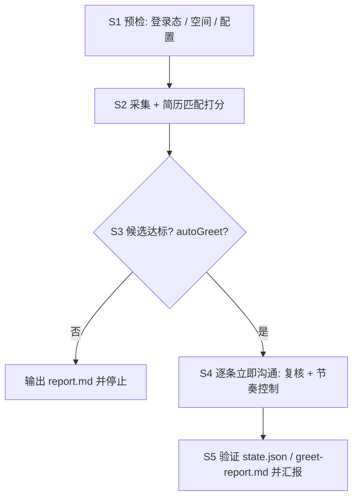

# BOSS直聘 AI 岗位筛选与招呼

所有页面操作走 `ego-browser`（先执行 `ego-browser skill` 获取当前版本用法）。采集与打招呼逻辑已封装为确定性脚本，条件全部写在 `$DATA/config.json`。

先把 `SKILL` 设为本次加载的 `SKILL.md` 所在绝对目录。安装可能是项目级或全局，也可能由不同 Agent 管理，不能假设固定安装在 `~/.agents/skills`。脚本始终使用技能包中的版本，运行数据独立保存在用户目录。

```bash
SKILL="/path/to/installed/boss-ai-job-hunter"
DATA="${BOSS_JOB_HUNTER_HOME:-$HOME/.boss-job-hunter}"
node "$SKILL/scripts/init.mjs"
```

初始化不会覆盖已有配置。首次使用必须先与用户核对城市、规模、薪资、搜索词及匹配权重；示例是广州、20-99 人、11K 起的通用 AI/前端配置，并非用户简历画像。配置字段见 [references/configuration.md](references/configuration.md)。

后文所有配置、候选和状态文件都位于 `$DATA`。默认是 `~/.boss-job-hunter/`；如使用自定义目录，先将其绝对路径导出为 `BOSS_JOB_HUNTER_HOME`，初始化和后续命令均使用该环境变量。

## Application Layer

### 场景识别（MANDATORY 先声明）

| 用户请求 | 模式 | 入口 |
|---|---|---|
| 开始找工作、筛职位、打招呼 | 执行 | S1 → S2 → S3 → S4 → S5 |
| 只看候选、先不沟通 | 只读 | S1 → S2 → 输出 report.md |
| 改规模/薪资/关键词/搜索词 | 调整 | 编辑 config.json → S2 |
| 采集失败、打招呼失败 | 排障 | Troubleshooting |

### 工作流



## Domain Layer

### S1 预检

1. 确认 Node.js 和 `ego-browser` 可用，执行 `ego-browser skill` 并按当前版本指南使用浏览器。如果命令缺失，先完成该浏览器的安装配置，不要直接用 `node` 执行采集/沟通脚本；脚本需要 `ego-browser nodejs` 提供的 `taskSpace`。
2. 按配置续用或创建空间，打印登录态，确认浏览器里是用户的 BOSS 会话：

   ```bash
   ego-browser nodejs <<'EOF'
   const fs = await import("node:fs/promises");
   const os = await import("node:os");
   const dir = process.env.BOSS_JOB_HUNTER_HOME || `${os.homedir()}/.boss-job-hunter`;
   const file = `${dir}/config.json`;
   const cfg = JSON.parse(await fs.readFile(file, "utf8"));
   let task;
   if (cfg.spaceId) {
     try { task = await taskSpace(cfg.spaceId); } catch {}
   }
   task ??= await taskSpace(cfg.spaceName);
   if (task.spaceId !== cfg.spaceId) {
     cfg.spaceId = task.spaceId;
     await fs.writeFile(file, JSON.stringify(cfg, null, 2));
   }
   const page = task.page("p1");
   await page.goto("https://www.zhipin.com/web/geek/jobs", { waitUntil: "domcontentloaded" });
   console.log(await page.evaluate(() => ({
     url: location.href,
     loggedIn: !!document.querySelector('a[href$="/web/geek/chat"]'),
     risk: /环境存在异常|安全验证/.test(document.body.innerText),
   })));
   EOF
   ```

3. `loggedIn:false` → 用 `task.handOff()` 请用户手动登录，用户允许继续后用配置中的 `spaceId` 恢复；不要伪造 cookie/token。
4. `risk:true` → 停止，等待 5–10 分钟后再检查，期间不要重复导航。
5. 首次使用或条件变化时，只改 `$DATA/config.json`：`city`、`companyScale`（20-99 人 = `302`）、`salaryMinK`、`queries`、`titleRejectAny`、`minGreetScore`、`maxGreetPerRun`、`greetDelaySec`。
6. `spaceId` 初始为 `null`，不携带作者本机空间。脚本优先续用该 id；空间已结束时按 `spaceName` 新建并把新 id 写回 config。用户接管时停止并等待授权继续，不要并发开第二个空间。

### S2 采集 + 打分

```bash
ego-browser nodejs < "$SKILL/scripts/collect.mjs"
```

脚本行为（无需人工介入）：

- 按 `queries` 逐个打开 `city + scale + query` 列表页，滚动加载（每屏 15 条）。
- 解码职位卡薪资（BOSS 用私有区字符 U+E031–U+E03A 表示 0–9）。
- 硬过滤：列表 URL 使用配置的 `companyScale` 筛选规模；薪资下限 ≥ `salaryMinK`；标题按配置的方向词和排除词筛选。
- 另开一条通道：标题只写「前端/全栈/Web」（AI 只在 JD 里）也放行到详情，JD 的 AI 能力命中 <2 个词则判 `no-ai-jd` 跳过。
- 文本先 `NFKC` 归一再去零宽/空白：BOSS 的 JD 混有康熙部首同形字（⽤ U+2F65、⼼ U+2F3C），不归一会导致中文关键词漏命中。
- 对预过滤命中项在原列表页点击卡片，读右侧 `.job-detail-container` 的职位描述，按 config 权重打分（AI 能力 / 前端栈 / 全栈后端 / 工程交付 − 负面词）。
- 输出 `$DATA/candidates.json` 与 `$DATA/report.md`；stdout 打印前 15 条摘要。

`ok:false` 时按 `error` 处理：`NOT_LOGGED_IN` → 回 S1；`RISK_CONTROL` → 停止并等待冷却，不要重跑。

### S3 候选复核

1. 读 `$DATA/report.md`，向用户给出 Top 5–10（分数、职位、薪资、公司、匹配点）。
2. `config.autoGreet=false` 或用户要求先确认 → 到此停止，等用户点头再进 S4。
3. `autoGreet=true`（用户已授权"满足条件就沟通"）→ 直接进 S4，同时在汇报里列出即将沟通的名单。
4. 同分时按薪资下限从高到低；`alreadyGreeted` 的条目脚本会自动跳过。

### S4 逐条立即沟通

```bash
# 单批 8 条约 4–6 分钟：调用时给足超时（timeout≥900 或后台任务），不要用默认 300s 截断
ego-browser nodejs < "$SKILL/scripts/greet.mjs"
```

脚本对队列中每条职位：

1. 打开 `job_detail` 页，按配置复核 `.job-sider` 公司规模和薪资下限。
2. 按钮文案为"继续沟通" → 跳过（已联系过，不重复打扰）。
3. `page.mouse.click` 真实点击"立即沟通"（不是 JS `el.click()`），等待 `.greet-boss-dialog`。
4. 出现"已向BOSS发送消息"或按钮变"继续沟通" → 记为成功，写 `state.json`。
5. 命中"上限/限制/无法发送" → `stopReason=DAILY_LIMIT`，立即停止，不再触发风控。
6. 两条之间等待 `greetDelaySec`（默认 25–45 秒随机），禁止并发、禁止连点。

### S5 验证与汇报

1. 读 `$DATA/greet-report.md` 与 `$DATA/state.json`：每条成功记录带 `evidence`（`dialog` 弹层、`chat-redirect` 跳会话、`button-changed` 按钮变"继续沟通"）。
2. 需要确认真实会话时，打开 `https://www.zhipin.com/web/geek/chat` 检查新会话（只读，不发送额外消息）；若该空间已被用户接管，先请用户确认再 `takeOverTaskSpace(<spaceId>)`。
3. 失败项保留在 `candidates.json`，下次运行自动重试；`state.json` 里 `ok:true` 的永不重发。

## 硬性规则

- **禁止直接请求站内 wapi**（`/wapi/zpgeek/...`）。连续手工请求会触发 `code 37 您的环境存在异常`，且可能升级为验证码；一切数据从 UI 获取。
- 列表页 `&page=2` 无效，只能滚动加载；每个 query 默认滚动 `scrollsPerQuery` 次。
- 岗位薪资文本是私有区字符，必须解码后再比较；`元/天`、`元/时` 不算月薪，直接淘汰。
- 同一 `jobId` 只沟通一次；不要用"换搜索词重新打招呼"绕过。
- 单次运行上限 `maxGreetPerRun`（默认 8），不要为提高产出改大。
- 用户未授权时不得批量点击；`autoGreet=false` 必须停下来等确认。

## Troubleshooting

| 现象 | 原因 | 处理 |
|---|---|---|
| `NOT_LOGGED_IN` | 会话失效 | handOff 让用户登录，恢复同一空间 |
| `RISK_CONTROL` / code 37 | 请求过密或手工打接口 | 停止脚本 5–10 分钟，只用 UI 操作 |
| 薪资显示 `-K` | 私有区数字 | 用脚本内 `decodePua`，不要手写解析 |
| 公司规模不符 | 详情页 `.job-sider` 文本异常 | 跳过该条，不强行沟通 |
| 打招呼无反应 | 按钮在视口外/被浮层挡住 | 脚本取可见按钮坐标点击；仍失败则记录并继续下一条 |
| `DAILY_LIMIT` | BOSS 当日沟通上限 | 停止，次日再跑；`state.json` 已避免重复 |
| `Control of this task space is with the user` | 用户接管了浏览器 | 不要重试/抢回；请用户回复继续后 `takeOverTaskSpace(spaceId)` |
| 详情面板标题对不上 | 列表滚动后旧面板 | 脚本会重试一次；失败记 `detailError` 并继续 |
